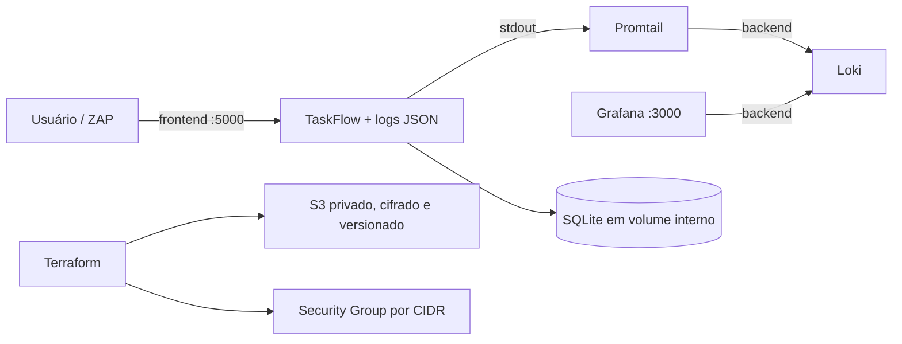

# Atividade 2 — DAST, IaC e Observabilidade

Esta extensão da TaskFlow leva os gates da Atividade 1 para a aplicação em execução,
para a infraestrutura como código e para a resposta operacional a incidentes.

## Arquitetura



- `frontend`: recebe apenas os acessos locais à TaskFlow e ao Grafana.
- `backend`: rede interna para TaskFlow, Promtail, Loki e Grafana.
- O SQLite usa volume e não expõe porta ao host.
- Segredos vêm do `.env`, que está ignorado; somente `.env.example` é versionado.

## Módulo 4 — DAST

- [`app_fixed_dast.py`](app_fixed_dast.py): sinks de XSS protegidos por autoescape,
  `/debug/info` removido e debug desligado por padrão.
- [`Dockerfile.dast`](Dockerfile.dast): imagem não-root usada no scan.
- [`.zap/rules.tsv`](.zap/rules.tsv): exceção específica e justificada.
- [`dast.yml`](.github/workflows/dast.yml): build, container, espera ativa, ZAP e artefatos.
- [`docs/dast.md`](docs/dast.md): antes × depois e OWASP Top 10.

Executar:

```bash
gh workflow run dast.yml
```

## Módulo 5 — IaC

- [`docker-compose.yml`](docker-compose.yml): redes isoladas, filesystem read-only,
  usuário não-root, capabilities removidas, healthcheck e limites de recursos.
- [`infra/main.tf`](infra/main.tf): S3 privado, cifrado, versionado e com access logging;
  Security Group restrito por `allowed_ip_cidr`.
- [`iac-scan.yml`](.github/workflows/iac-scan.yml): Checkov, Trivy config e
  `terraform validate` como gates. Ele roda em todo PR, sem `paths`, para que um required
  check nunca fique pendente em mudanças fora de `infra/`.
- [`docs/iac.md`](docs/iac.md): achados antes × depois e justificativas das exceções.

Executar:

```bash
gh workflow run iac-scan.yml
```

## Módulo 6 — Observabilidade e incidente

- [`app_instrumented.py`](app_instrumented.py): logs JSON com `request_id` e eventos de
  login, listagem e criação, sem senha, token ou cookie.
- [`docker-compose.yml`](docker-compose.yml): TaskFlow + Promtail + Loki + Grafana.
- [`docs/observabilidade.md`](docs/observabilidade.md): consultas LogQL e simulação.
- [`docs/runbook-login-bruteforce.md`](docs/runbook-login-bruteforce.md): quatro fases do
  NIST SP 800-61.
- [`observability-smoke.yml`](.github/workflows/observability-smoke.yml): confirma o
  envio dos eventos ao Loki e a higiene dos logs.

Executar localmente:

```bash
cp .env.example .env
# Substitua todos os placeholders por valores gerados localmente.
docker compose up -d --build --wait
scripts/simular-forca-bruta.sh
```

Executar o workflow:

```bash
gh workflow run observability-smoke.yml
```

## Gates esperados na proteção da `main`

- `DAST - ZAP Baseline`
- `IaC - Checkov`
- `IaC - Terraform validate`
- `IaC - Trivy config`
- `Observability - logs seguros no Loki`

Esses checks devem ser adicionados aos gates da Atividade 1 depois que aparecerem pelo
menos uma vez no GitHub Actions.

## Higiene e decisões

- Workflows usam `permissions: contents: read` e actions fixadas por SHA.
- Não há `continue-on-error`, `--exit-zero` ou `soft_fail` nos gates.
- O Checkov só é ignorado com justificativa junto ao recurso.
- HSTS é responsabilidade do proxy TLS; a exceção do ZAP vale somente no HTTP local.
- O custo do rigor é manutenção maior de regras, versões e evidências; o benefício é um
  merge bloqueado por falhas reproduzíveis em vez de relatórios decorativos.
